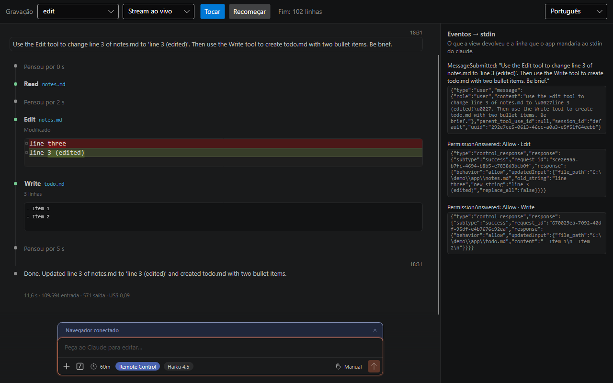
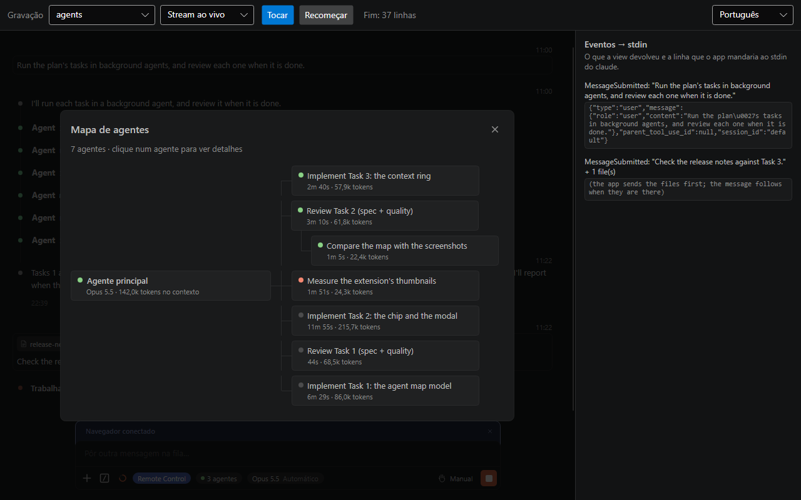
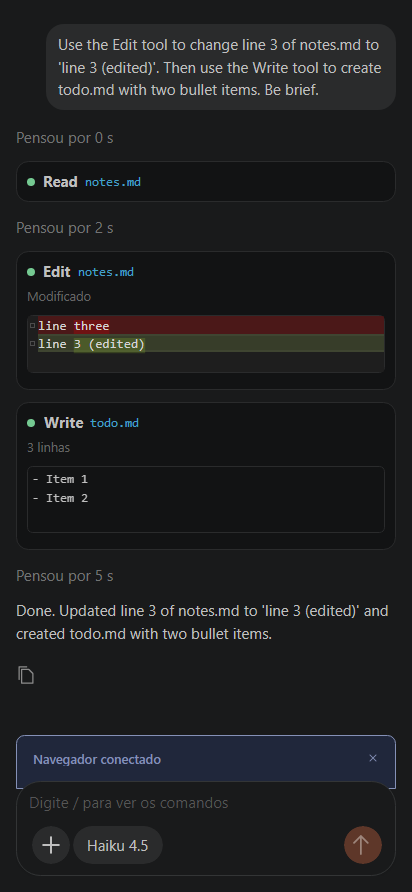

# Claude Visual Chat

[English](README.md)

Um controle Avalonia que desenha conversas do [Claude Code](https://github.com/anthropics/claude-code) do jeito
que a extensão Claude Code do VS Code desenha. Entregue a ele as linhas que o `claude -p` escreve em stream-json, ou um
arquivo de sessão que o Claude Code guarda no disco; ele mostra a conversa e devolve o que o usuário fez (uma
mensagem, um sim ou não a um pedido de permissão, uma troca de modo, de modelo ou de effort, um comando `/`, uma imagem ou um arquivo, parar) como eventos .NET.

> Projeto da comunidade, sem vínculo com a Anthropic e sem o endosso dela.



- **Igual à extensão.** O layout segue a extensão Claude Code do VS Code: a linha do tempo com as bolinhas, as
  chamadas de ferramenta com os subtítulos, o diff lado a lado, o pedido de permissão e a caixa de resposta, com as
  mesmas fontes, tamanhos, espaçamentos e cores.
- **As cores do VS Code atual.** O padrão são as cores do "Dark 2026", o tema escuro padrão do VS Code atual. O
  "Dark Modern" vem junto, pronto para ligar (veja [Cores](#cores)).
- **Stream ou histórico.** A saída ao vivo do `claude -p --output-format stream-json`, ou um arquivo de sessão inteiro
  (`~/.claude/projects/<pasta>/<id da sessão>.jsonl`).
- **Desktop ou celular.** O layout da extensão por padrão, e um layout de toque para o celular
  (`Layout = ChatLayout.Touch`): texto maior, sem linha do tempo, a mensagem do usuário num balão, folhas para o
  modelo, o **+** e o uso, e um microfone para o seu próprio ditado (veja [Layout de toque](#layout-de-toque)).
- **Textos em inglês e em português do Brasil** já prontos; qualquer texto pode ser trocado.
- **Nada escondido.** A biblioteca não abre links, não baixa imagens, não roda processo e não toca em arquivo. O seu
  app sobe o `claude` e leva as linhas de um lado para o outro.

Feita para `netstandard2.0` com o Avalonia 11.0.10. As únicas dependências são `Avalonia` 11.0.10,
`Markdown.Avalonia.Tight` 11.0.2, `SkiaSharp` 2.88.7 (para reduzir e decodificar as imagens anexadas) e
`System.Text.Json` 8.0.5.

## Instalação

```sh
dotnet add package ClaudeVisualChat.Avalonia
```

O controle desenha as próprias partes, mas usa por dentro os controles padrão do Avalonia (caixa de texto, caixa de
seleção, barras de rolagem). Por isso, **o seu app precisa de um tema Avalonia**: Fluent ou Simple.

```xml
<Application xmlns="https://github.com/avaloniaui" RequestedThemeVariant="Dark">
  <Application.Styles>
    <FluentTheme />
  </Application.Styles>
</Application>
```

Depois, ponha a view onde quiser o chat:

```xml
<Window xmlns="https://github.com/avaloniaui"
        xmlns:cvc="using:ClaudeVisualChat.Controls">
  <cvc:ClaudeChatView Name="Chat" />
</Window>
```

## Início rápido

O seu app sobe o `claude -p` com stream-json na entrada e na saída, manda cada linha da saída para a conversa na
thread da UI e escreve na entrada o que o usuário faz:

```csharp
using System.Diagnostics;
using System.Text;
using Avalonia.Threading;
using ClaudeVisualChat;
using ClaudeVisualChat.Protocol;

var conversation = new ChatConversation();
Chat.Conversation = conversation; // a ClaudeChatView acima

var claude = Process.Start(new ProcessStartInfo("claude",
    "-p --input-format stream-json --output-format stream-json --verbose " +
    "--include-partial-messages --permission-prompt-tool stdio")
{
    WorkingDirectory = projectFolder, // a pasta em que o Claude trabalha
    RedirectStandardInput = true,
    RedirectStandardOutput = true,
    StandardOutputEncoding = Encoding.UTF8,
    UseShellExecute = false,
})!;

// claude -> view: uma linha JSON por evento, aplicada na thread da UI
claude.OutputDataReceived += (_, e) =>
{
    if (e.Data != null) Dispatcher.UIThread.Post(() => conversation.AppendLine(e.Data));
};
claude.BeginOutputReadLine();
// primeiro, o aperto de mão de controle que os SDKs oficiais mandam; os pedidos abaixo foram conferidos depois dele
Send(StdinMessages.Initialize("init_1"));

// view -> claude: cada coisa que o usuário faz é uma linha no stdin do claude
var ids = 0;
void Send(string line) { claude.StandardInput.Write(line + "\n"); claude.StandardInput.Flush(); }
conversation.MessageSubmitted += (_, e) => Send(StdinMessages.UserMessage(e.Text, e.Images));
conversation.PermissionAnswered += (_, e) => Send(StdinMessages.PermissionResponse(e));
conversation.PermissionModeRequested += (_, e) => Send(StdinMessages.SetPermissionMode("req_" + ++ids, e.Mode));
conversation.ModelRequested += (_, e) => Send(StdinMessages.SetModel("req_" + ++ids, e.Model));
conversation.EffortRequested += (_, e) => Send(StdinMessages.ApplyEffort("req_" + ++ids, e.Effort));
conversation.StopRequested += (_, _) => Send(StdinMessages.Interrupt("req_" + ++ids));
```

Um `/model x` ou `/effort x` digitado também muda o claude, mas o chip só acompanha depois do próximo `system/init` ou
de uma resposta do `GetSettings`; por isso envie o `GetSettings` depois deles.

No Windows, um `claude` instalado pelo npm é `claude.cmd`: suba-o com `cmd /c claude ...` ou pelo caminho completo.

O `ChatConversation` não é thread-safe: chame-o na thread da UI, como acima. As linhas que ele não entende (em branco,
que não são JSON, de tipo desconhecido) são puladas. `ClaudeChatView.AvailableModes` define os modos de permissão
oferecidos (`plan`, `default`, `acceptEdits` e `auto` por padrão); os modelos ficam em
`ChatConversation.AvailableModels` (nenhum por padrão, o que esconde o chip de modelo; veja
[Modelo e effort](#modelo-e-effort)). O `PermissionModeRequested` e o `ModelRequested` disparam quando o usuário pede a
troca, antes de o claude confirmar: a escolha de modo ou de modelo só mostra o novo valor quando o claude o informa.

Uma view pode mostrar várias conversas, uma de cada vez: basta pôr outra em `Conversation`. O que o usuário escreveu e
não mandou fica com a conversa dele e volta com ela.

Uma mensagem que não chega ao claude (a conexão caiu, um relé a recusou) pode ser desfeita com os argumentos do
evento, na hora, dentro do handler, ou depois:

```csharp
conversation.MessageSubmitted += (_, e) =>
{
    if (!TrySend(StdinMessages.UserMessage(e.Text))) conversation.UndoSubmit(e);
};
```

A mensagem sai da lista, o "trabalhando" some quando nada mais o mantém, e o texto volta à caixa de resposta se ela
estiver vazia (o `SubmitUndone` leva o texto, para quem quiser pô-lo em outro lugar).

## Anexos

A caixa de resposta aceita imagens: o botão **+** abre o seletor de arquivos, o Ctrl+V cola uma imagem (se a área de
transferência também tem texto, o texto vence) e dá para arrastar arquivos para a caixa. Cada uma aparece como uma
pílula com miniatura, nome, tamanho e um ×; um clique na miniatura abre a prévia em tela cheia. As imagens são
reduzidas para caber (`MaxImageSide`, 1568 px por padrão, e `ImageBudgetBytes`, 3.750.000 bytes para a mensagem
inteira), no máximo `MaxImages` (10) por mensagem; uma imagem recusada diz o motivo (`ImageTooBig`, `TooManyImages` e
`NotAnImage` no `ChatStrings`). Uma mensagem pode ter só imagens. O host as manda junto com o texto, e a mensagem do
usuário as mostra como miniaturas acima do texto, numa linha só com os arquivos dela (48 px de altura e até 120 px de
largura, como na extensão):

```csharp
conversation.MessageSubmitted += (_, e) => Send(StdinMessages.UserMessage(e.Text, e.Images));
```

O `ChatConversation.AddImageAsync(bytes)` anexa uma imagem a partir do seu código. A redução e a decodificação usam o
SkiaSharp 2.88.7, de que o pacote agora depende; o Avalonia traz as bibliotecas nativas dele. No Windows a área de
transferência é lida pelas chamadas do sistema (PNG, depois DIB e DIBV5); nos outros sistemas, pelo `image/png` do
Avalonia.

## Arquivos anexados

A caixa de resposta também aceita arquivos PDF, de texto e CSV: o botão **+**, o arrastar e o Ctrl+V de arquivos
copiados no Explorer servem para eles como para as imagens, e imagens e arquivos juntos vão cada um para o seu lugar (um
texto na área de transferência ainda vence os arquivos). Com o `MaxFiles` em 0, o diálogo do **+** só oferece imagens. Vale como arquivo um `.pdf` que começa
com `%PDF-`, ou um `.txt`, `.log`, `.md`, `.json` ou `.csv` sem byte nulo nos primeiros 8 KB; no máximo `MaxFiles` (5)
por mensagem e `MaxFileBytes` (25 MB) cada um. Um arquivo recusado diz o motivo (`FileTooBig`, `FileNotSupported` e
`TooManyFiles` no `ChatStrings`). Cada um aparece como um chip com o ícone do tipo, o nome e o tamanho. Pelo seu código:
`ChatConversation.AddFileAsync(caminho)` (lê só o tamanho e os primeiros 8 KB) ou `AddFile(nome, bytes)`.

**Quem manda os arquivos é o seu app; o componente só os mostra.** O claude lê um arquivo de um caminho na máquina
dele, por isso o `MessageSubmitted` traz os arquivos em `e.Files` e o texto sem eles. O seu app manda cada arquivo para
a máquina em que o claude roda (a partir do `ChatFile.LocalPath`, em partes, ou do `ChatFile.Content`), escreve o
`Progress` (de 0 a 1) enquanto manda e o `RemotePath` quando o arquivo chega, e então manda a mensagem com uma linha
marcadora por arquivo no fim:

```csharp
conversation.MessageSubmitted += async (_, e) =>
{
    if (e.Files.Count == 0) { Send(StdinMessages.UserMessage(e.Text, e.Images)); return; }
    try
    {
        var markers = new List<string>();
        foreach (var file in e.Files)
        {
            // do seu app: copiar ou subir o arquivo; o progresso vai na thread da UI
            file.RemotePath = await UploadAsync(file, p => Dispatcher.UIThread.Post(() => file.Progress = p));
            markers.Add(AttachedFileLine.Format(file.RemotePath)); // "[attached file: <caminho>]"
        }
        var text = e.Text.Length == 0 ? string.Join("\n", markers) : e.Text + "\n" + string.Join("\n", markers);
        Send(StdinMessages.UserMessage(text, e.Images));
    }
    catch (Exception) // qualquer falha: este handler é async void, então nada pode escapar dele
    {
        conversation.UndoSubmit(e); // a mensagem e os arquivos voltam para a caixa de resposta
    }
};
```

Enquanto o `Progress` está definido e o `RemotePath` não, o chip diz "Enviando 42%" e fica sem o ×. A linha marcadora é
`[attached file: <caminho>]`, sozinha na linha, no fim da mensagem; só contam as marcadoras de lá, então uma que o
usuário escreva no meio do texto continua texto. Quando o claude repete a mensagem, e num arquivo de sessão, a conversa
tira essas linhas do texto e mostra um chip para cada uma (com o nome da última parte do caminho e sem tamanho). O
`AttachedFileLine.Split(mensagem)` faz o mesmo para o seu código. Defina o `Progress` e o `RemotePath` na thread da UI.

## Comandos

O botão `/` da barra, ou digitar `/` na caixa vazia, abre a paleta de comandos: um campo de filtro e, abaixo, os
comandos por nome exato, prefixo, nome que contém e descrição. As setas movem, o Enter executa, o Tab insere o comando
na caixa e o Esc fecha. Os comandos são os que o claude lista na resposta do `initialize` (o pedido de controle que o
seu app mandou no início rápido): passe essa resposta ao `AppendLine` ou defina-os você mesmo.

```csharp
conversation.Commands = new[] { new ChatCommand("review", "Revisar um pull request", "<pr>") };
```

Um comando que não é local vai ao claude como o texto de uma mensagem, como qualquer outro. Os que a própria conversa
trata (`ChatConversation.LocalCommands`: `context`, `usage`, `remote-control`, `rc` e `chrome`) disparam o
`CommandInvoked` e não mandam nada:

```csharp
conversation.CommandInvoked += (_, e) =>
{
    switch (e.Name)
    {
        case "context": Send(StdinMessages.GetContextUsage("req_" + ++ids)); break;  // a resposta enche o painel
        case "chrome": Send(StdinMessages.GetChromeStatus("req_" + ++ids)); break;
        case "remote-control": case "rc": ToggleRemoteControl(); break;               // veja abaixo
    }
};
```

No `/chrome`, o claude responde ao `GetChromeStatus` com um `ControlAcknowledged` cujo `Response` diz `connected`
ou `paired_browser`; o componente não lê isso por você: o seu app lê o `ControlAcknowledged.Response` e define o
`conversation.BrowserStatus`.

O `/context` e o `/usage` também abrem um painel sobre a caixa de resposta (`ChatConversation.ShownPanel`) com os
números que o claude informou por último: o `ContextUsage` vem da resposta do `get_context_usage`; o `UsageLimits`, das linhas
`rate_limit_event` que o claude escreve, então o seu app só precisa passar todas as linhas pelo `AppendLine`.
(`conversation.Apply(new UsageLimitsReported(limits))` é uma substituição opcional.) Sem dados ainda, o painel mostra
"…" enquanto a conversa está ocupada e "Ainda sem dados de uso" nos demais casos. O Esc fecha o painel.

## Modelo e effort

A barra mostra um chip com o modelo e o effort (**Opus 5.5 High**). Ele abre um menu com os modelos e um controle
deslizante com os níveis de effort que o modelo escolhido aceita. Os modelos vêm da conversa (não da view):

```csharp
conversation.AvailableModels = new[]
{
    new ChatModel("opus", "claude-opus-5-5", "Opus 5.5", "Para trabalho complexo e o dia a dia",
        new[] { "low", "medium", "high", "xhigh", "max" }),
    new ChatModel("haiku", "claude-haiku-4-5-20251001", "Haiku 4.5", "O mais rápido para respostas curtas",
        Array.Empty<string>()), // não aceita effort
};
```

A resposta do `initialize` traz a mesma lista, e o `AppendLine` a preenche. Como o modelo e o modo, o effort é pedido
primeiro e só aparece depois que o claude confirma: o `EffortRequested` traz o nível (`null` para o do próprio
modelo), e a resposta do `get_settings`, ou um `SettingsApplied`, move o chip. Um id de modelo com sufixo (`claude-opus-5-5[1m]`) encontra o seu modelo, e o chip mostra o sufixo
(**Opus 5.5 [1m] High**).

```csharp
conversation.EffortRequested += (_, e) =>
{
    Send(StdinMessages.ApplyEffort("req_" + ++ids, e.Effort));
    Send(StdinMessages.GetSettings("req_" + ++ids)); // a resposta diz o nível que vale agora
};
```

## Cache de prompt, browser e Remote Control

- **Cache de prompt.** Um relógio na barra conta os minutos que restam ao cache de prompt do claude, a partir do uso
  de cache da última resposta. Fica vermelho quando o cache provavelmente expirou. O `Clock` é a fonte de hora que ele
  lê (o exemplo toca a da própria gravação).
- **Browser.** O seu app informa o estado da extensão de browser: `BrowserStatus` (`Off`, `Connecting`, `Connected`,
  `NoBrowser`, `Error`, com `BrowserError`). Uma faixa sobre a caixa o conta, e o botão de desconectar dispara o
  `BrowserDisconnectRequested`; o estado só muda quando você o define.
- **Remote Control.** O `RemoteControlStatus` (`Off`, `Connecting`, `Connected`, `Error`), o `RemoteControlUrl` e o
  `RemoteControlError` mostram uma pílula na barra. Um clique nela dispara o `RemoteControlLinkRequested` (`RemoteControlLinkRequestedEventArgs`) com o link,
  que o seu app abre (a biblioteca não abre nada). As linhas `bridge_state` do claude movem o estado sozinhas.

```csharp
conversation.BrowserStatus = ChatBrowserStatus.Connected;
conversation.BrowserDisconnectRequested += (_, _) =>
{
    DisconnectBrowser(); // do seu app
    conversation.BrowserStatus = ChatBrowserStatus.Off;
};

conversation.RemoteControlStatus = ChatRemoteControlStatus.Connecting;
Send(StdinMessages.RemoteControl("req_" + ++ids, true)); // a resposta traz o link
conversation.RemoteControlLinkRequested += (_, e) =>
    Process.Start(new ProcessStartInfo(e.Url) { UseShellExecute = true });
```

## Mapa de agentes



Depois que a conversa teve um agente, a barra mostra um chip com quantos estão trabalhando (**● 3 agentes**,
**0 agentes** quando todos terminaram, como a extensão conta); a bolinha fica verde enquanto algum trabalha. Um clique nele, ou o
`ChatConversation.ShowAgents()`, abre o mapa de agentes sobre a view (o `ShownPanel` vira `ChatPanel.Agents`): o
cartão do agente principal à esquerda, com o modelo e os tokens no contexto dele, e os agentes à direita, o mais novo
em cima, cada um com a bolinha, a descrição, o tempo e os tokens ("7m 14s · 168,5k tokens"); um agente chamado por
outro fica embaixo de quem o chamou. Um clique num agente abre a ficha dele: "Rodando · general-purpose · Sonnet 5.5 ·
segundo plano", quem o chamou, o tempo e os tokens, o que ele está fazendo enquanto roda e a resposta. O Esc volta da
ficha e fecha o mapa; o `ClosePanel()` também fecha.

Não há nada a configurar: o mapa sai das linhas que o `AppendLine` já recebe. As chamadas da ferramenta Agent, as
linhas `system/task_started`, `task_progress`, `task_updated` e `task_notification` do claude e o resultado da chamada
Agent preenchem o `ChatConversation.Agents` (`AgentInfo`: descrição, tipo, modelo, estado, início, tempo, tokens, usos
de ferramenta, atividade, resultado, quem chamou e profundidade) e o `RunningAgents`; um comando que um agente roda
(`local_bash`) não é agente. O `LoadTranscript` monta o mesmo mapa a partir de um arquivo de sessão, em que cada fim
vem numa mensagem `<task-notification>` (que fica fora da lista); um agente sem fim ali aparece como parado, e uma linha
dele que chegue depois, ao vivo (as linhas de tarefa dele, ou uma linha do próprio agente), o põe para rodar de novo. O
tempo de um agente rodando conta pelo `Clock`. O chip aparece assim que o `Agents` tem um, ao vivo ou vindo de um
arquivo de sessão.

O cartão principal diz "Agente principal": o componente ainda não tem um título para a conversa. A ficha da extensão
também traz o prompt do agente, as chamadas de ferramenta dele, "Open transcript" e "Stop agent", que precisam da
transcrição do próprio agente e de um jeito de pará-lo; eles não estão aqui.

## Anel de contexto

Quando mais da metade da janela de contexto está em uso, a barra mostra o anel da extensão: uma pizza de 20 px no
laranja argila do botão de enviar, que enche em três degraus (50, 75 e 99 %), com a dica "29% do contexto restante até
o auto-compactar." Ele lê o `ChatConversation.ContextUsage`, que a resposta do `get_context_usage` preenche; por isso
peça o uso quando quiser que o anel se mova (depois de cada resposta, por exemplo):

```csharp
conversation.PropertyChanged += (_, e) =>
{
    if (e.PropertyName == nameof(ChatConversation.IsBusy) && !conversation.IsBusy)
        Send(StdinMessages.GetContextUsage("req_" + ++ids));
};
```

Um clique no anel abre o painel do `/context` (dispara o `CommandInvoked` com `context`, como o comando). A extensão
compacta a conversa nesse clique; aqui um clique sem querer não pode fazer isso, então ele só mostra os números. As
cores são `ClaudeChat.ContextRingTrack` e `ClaudeChat.ContextRingFill`.

## Abrir uma sessão gravada

O Claude Code guarda cada sessão em `~/.claude/projects/<pasta>/<id da sessão>.jsonl`. Para mostrar uma:

```csharp
conversation.WorkingDirectory = @"C:\work\my-app"; // caminhos dentro desta pasta aparecem relativos
conversation.LoadTranscript(File.ReadLines(sessionFile));
```

O `LoadTranscript` substitui o que a conversa tinha. As linhas que não fazem parte da conversa (anexos, histórico de
arquivos e afins) são puladas.

## Plano e permissão

No desktop, o pedido de permissão pergunta como a extensão 2.1.310: um título que diz a ferramenta e no que ela mexe, o
comando, o diff ou a entrada embaixo, e as respostas numeradas na ordem em que aparecem (o dígito depois do último vai
para o campo; "Não" recusa na hora com o que estiver escrito nele). A opção 2 diz a regra e onde ela fica guardada (por
exemplo, "este projeto (só você)"). As respostas ficam desligadas por 500 ms depois que o cartão aparece, e um
pedido que chega enquanto a pessoa digita espera até a digitação parar. Um botão no alto, à direita, dobra o cartão até o
título, para ler a conversa que está atrás. O layout de toque mantém o pedido como era na 0.5.0, fora o plano.

O que o seu app faz é o que ele já fazia: mandar o que `PermissionAnswered` e `PermissionModeRequested` trazem e dar à
view todas as linhas que o claude escreve, os erros também.

```csharp
conversation.PermissionAnswered += (_, e) => Send(StdinMessages.PermissionResponse(e));
conversation.PermissionModeRequested += (_, e) => Send(StdinMessages.SetPermissionMode("req_" + ++ids, e.Mode));
```

Um pedido de `ExitPlanMode` é o cartão do plano, "Aceitar este plano?", e o plano abre como um documento sobre a lista.
Três coisas que o host precisa saber:

- **O primeiro "Sim" depende de `ClaudeChatView.AvailableModes`.** Com `auto` entre eles, a opção diz "Sim, e usar o
  modo automático" e pede `auto`; sem ele, "Sim, e aceitar as edições automaticamente", e pede `acceptEdits`. "Sim, e aprovar as
  edições uma a uma" pede `default`.
- **Um "Sim" dispara dois eventos, nesta ordem e sem espera entre eles:** `PermissionModeRequested` com o modo e depois
  `PermissionAnswered` com Allow. Mande-os ao claude na ordem em que chegam, porque o claude os aplica na ordem em que
  os lê. Se o claude responder a um pedido de controle com erro depois de um pedido de `auto`, o componente pede
  `acceptEdits`. Ele não sabe qual pedido falhou (os ids são seus), então um erro de qualquer outro pedido de controle
  nessa janela tem o mesmo efeito; o pior caso é `acceptEdits`, o modo mais restritivo.
- **"Não, continuar planejando" é uma recusa com mensagem:** `PermissionAnsweredEventArgs.Message` traz o que a pessoa escreveu
  e, havendo comentários no plano, os comentários e os trechos em que foram feitos. Uma recusa nunca passa de 4.000
  caracteres (os trechos são encurtados primeiro, depois os comentários, depois o texto digitado).

O documento fecha quando o plano é aprovado e fica depois de um "Não". O Esc, o x e `CloseTopLayer()` o fecham, uma camada
por vez; só um Esc com o cartão por cima é "Não". Selecione um trecho para comentá-lo: os comentários esperam no cartão
("Continuar planejando") até a pessoa mandá-los como retorno. A linha do plano na lista o abre de novo.

## Chamadas de ferramenta

Cada chamada é uma linha da lista, desenhada como a extensão 2.1.310 a desenha: Bash e PowerShell com o comando numa
caixa IN (e um botão de copiar), Edit e Write com uma linha embaixo do nome (a mudança líquida de linhas) e o diff, Glob,
Grep e as ferramentas da web com uma linha que abre a saída, Agent com o prompt, as ferramentas MCP como "servidor
[ferramenta]" e o Claude in Chrome como "Claude in Chrome [ação]". Nada a configurar: elas vêm das linhas que o
`AppendLine` já recebe. O que o seu app pode querer saber:

- **Uma chamada aparece quando a entrada dela termina,** não como uma linha vazia quando o bloco começa; assim, quem lê
  `ChatConversation.Items` a vê um pouco mais tarde que antes. As chamadas de `ToolSearch`, e os resultados delas, nunca
  aparecem.
- **Um clique num diff da lista abre o Diff View** sobre a view inteira, lado a lado, com o caminho do arquivo no título.
  O Esc, o x dele e `CloseTopLayer()` o fecham (é uma camada, logo abaixo da prévia de imagem), e ele abre também numa view
  somente leitura. Numa view de 500 px de largura ou menos (só o layout desktop) a caixa de um Edit ou de um Write some,
  como na extensão; o layout de toque a mantém.
- **`ToolCallItem` traz mais:** `FullResultText` (o resultado inteiro, no máximo `ToolPresentation.MaxKeptResultChars`
  caracteres, sem os códigos de terminal nos comandos), `RejectionReason` (o que a pessoa escreveu ao recusar a chamada),
  `IsOutputExpanded` e `IsInputExpanded` (se uma caixa está aberta por inteiro) e `ResultImages`. Uma chamada recusada
  mostra a bolinha vermelha e, num Edit, num Write ou num comando, uma linha "Motivo:"; não há mais o rótulo "Recusado".
- **Uma captura de tela do Claude in Chrome** (a ação `computer`) aparece como miniatura, que abre a prévia de imagem,
  só quando o `content` do resultado traz um bloco de imagem; um relay que repassa só texto mostra "Ação concluída". Os
  campos da entrada do Chrome que as linhas leem vêm do esquema da ferramenta, não de uma gravação.
- **Um subagente em segundo plano tem uma linha embaixo da sua** que termina em "digite /tasks para ver a transcrição dele". Se o
  seu claude não tem `/tasks`, troque o texto: `ChatStrings.PortugueseBrazil with { AgentTasksHint = "..." }`. `AgentInfo.Prompt`
  e `AgentInfo.IsWaitingForPermission` estão nos agentes de `ChatConversation.Agents`; um pedido que vem sem `agent_id`
  é tomado como do agente cujo passo pediu.
- Os nomes das linhas de Agent, Web Fetch, Web Search e Claude in Chrome são textos do `ChatStrings` (`AgentToolTitle`,
  `WebFetchToolTitle`, `WebSearchToolTitle`, `ChromeToolTitle`), iguais nas duas línguas.

## Cores

Todas as cores, as duas fontes, os tamanhos de texto e alguns lugares vêm de recursos chamados `ClaudeChat.*` (as
chaves estão na tabela abaixo). O resto é fixo no tema: os títulos do Markdown (26, 19,5 e 15,2 px), algumas alturas
de linha e os espaçamentos, cantos e alturas medidos da extensão. No [layout de toque](#layout-de-toque) os tamanhos e
os lugares têm os valores do celular. Redefina qualquer chave nos recursos da view:

```xml
<cvc:ClaudeChatView>
  <cvc:ClaudeChatView.Resources>
    <SolidColorBrush x:Key="ClaudeChat.Background" Color="#101010" />
  </cvc:ClaudeChatView.Resources>
</cvc:ClaudeChatView>
```

As cores padrão são as do tema "Dark 2026" do VS Code. Para as do "Dark Modern", junte o dicionário dele aos recursos
da view:

```xml
<cvc:ClaudeChatView>
  <cvc:ClaudeChatView.Resources>
    <ResourceDictionary>
      <ResourceDictionary.MergedDictionaries>
        <ResourceInclude Source="avares://ClaudeVisualChat.Avalonia/Themes/DarkModern.axaml" />
      </ResourceDictionary.MergedDictionaries>
    </ResourceDictionary>
  </cvc:ClaudeChatView.Resources>
</cvc:ClaudeChatView>
```

As chaves, todas com o prefixo `ClaudeChat.`:

| Grupo | Chaves |
| --- | --- |
| Cores do tema (mudam com o tema do VS Code) | `Background`, `Surface`, `Border`, `BorderStrong`, `Foreground`, `ForegroundMuted`, `Accent`, `AccentFill`, `AccentForeground`, `FocusBorder`, `Warning`, `Error`, `Success`, `InputBackground`, `InputBorder`, `InputActiveBorder`, `PermissionActiveBorder`, `InputPlaceholder`, `HoverBackground`, `OptionBorder`, `TimelineLine`, `Dot`, `ToolBackground`, `CodeBackground`, `CodeForeground`, `CodeBlockBackground`, `PillBackground`, `PillHoverBackground` |
| Cores próprias da extensão | `DotSucceeded`, `DotFailed`, `DotRejected` (sem uso desde a 0.6.0), `SendBackground`, `SendForeground`, `FocusRing`, `Spinner`, `PlanCommentHighlight`, `SecondaryButtonBackground` |
| Sombras da caixa de resposta e das caixas de ferramenta (`BoxShadows`) | `ComposerShadow`, `ComposerFocusShadow`, `ComposerFocusShadowAcceptEdits`, `ComposerFocusShadowPlan`, `ComposerFocusShadowAuto`, `ToolContentFocusShadow` (o foco de uma caixa de ferramenta) |
| Diff | `DiffBackground`, `DiffForeground`, `DiffRemoved`, `DiffAdded`, `DiffRemovedText`, `DiffAddedText`, `DiffHatch`, `DiffGuide`, `DiffCurrentLine`, `DiffSign`, `DiffShadow`, `DiffFade`, `DiffExpandHover`, `DiffExpandPillHoverBorder`, `DiffViewShadow` |
| Fontes | `FontFamily` (`Segoe UI, Segoe WPC, Inter, sans-serif`), `MonoFontFamily` (`Consolas, Courier New, monospace`) |
| Tamanhos | `FontSize`, `LineHeight`, `SmallFontSize`, `SmallLineHeight`, `CodeFontSize`, `EditorFontSize`, `EditorLineHeight`, `PromptFontSize`, `PromptLineHeight`, `PromptCodeFontSize`, `PromptHintFontSize` |
| Lugares | `ListPadding`, `ComposerMaxWidth`, `ScrollBarGutter`, `PromptDetailMaxHeight` (o comando ou o diff de um pedido de permissão: um mais alto rola), `PromptDetailPeekHeight` (o mesmo enquanto o campo do "Não" está aberto), `PlanCommentsMaxHeight` (a lista de comentários no cartão do plano) |
| Ícones (`StreamGeometry`) | `Icon.ModeDefault`, `Icon.ModeAcceptEdits`, `Icon.ModePlan`, `Icon.ModeAuto`, `Icon.Send`, `Icon.Chevron`, `Icon.ChevronDown`, `Icon.ChevronUp`, `Icon.Add`, `Icon.Slash`, `Icon.Check`, `Icon.Clock`, `Icon.Close`, `Icon.Remove`, `Icon.ArrowLeft`, `Icon.FilePdf`, `Icon.FileText`, `Icon.Table`, `Icon.Copy`, `Icon.Mic`, `Icon.Refresh`, `Icon.Photo`, `Icon.Globe`, `Icon.Remote`, `Icon.External` |
| Menus e paleta de comandos | `MenuBackground`, `MenuForeground`, `ListHoverBackground`, `ListActiveBackground`, `ListActiveForeground`, `EffortThumbShadow` |
| Anexos | `AttachmentBackground`, `AttachmentHoverBorder`, `AttachmentRemoveFade`, `ThumbnailHoverBorder`, `PreviewOverlay`, `PreviewShadow` |
| Mapa de agentes e anel de contexto | `ModalOverlay`, `AgentRunning`, `AgentWaiting`, `ContextRingTrack`, `ContextRingFill` |
| Faixas e Remote Control | `BannerBackground`, `BannerForeground`, `BannerTint`, `BannerErrorBackground`, `BannerErrorForeground`, `RemoteControlForeground`, `RemoteControlHoverBackground`, `RemoteControlHoverForeground` |
| Painéis `/context` e `/usage` | `ContextColor1` a `ContextColor6` (as cores de gráfico da barra de contexto), `PanelShadow` |
| Layout de toque (veja [Layout de toque](#layout-de-toque)) | `UserBubble`, `SheetBackground`, `SheetGroupBackground`, `SheetHandle`, `SheetOverlay`, `PermissionWarningBorder` |

O `ScrollBarGutter` é o espaço que a lista deixa à direita para uma barra de rolagem desenhada por cima dela, como a do
Fluent. Uma barra com coluna própria, como a do Simple, já tem o seu espaço, e a lista fica com a largura toda.

## Textos

Os textos vêm do `ChatStrings`: `ChatStrings.English` (o padrão) ou `ChatStrings.PortugueseBrazil`. Ele é um record,
então troque só o que precisar, por cópia:

```csharp
Chat.Strings = ChatStrings.PortugueseBrazil;
Chat.Strings = ChatStrings.PortugueseBrazil with { InputPlaceholder = "Pergunte ao Claude…", TimeFormat = "H:mm" };
```

Os números usam os separadores do próprio record (`ThousandsSeparator` e `DecimalSeparator`), nunca a cultura do
sistema.

## Somente leitura

Defina `IsReadOnly` para mostrar uma conversa sem deixar o usuário agir sobre ela: uma sessão encerrada, uma máquina
fora do ar, um visualizador.

```xml
<controls:ClaudeChatView Conversation="{Binding Chat}" IsReadOnly="True" />
```

A caixa de resposta e o pedido de permissão ficam ocultos; a lista continua sendo desenhada, rolando e deixando
selecionar o texto. Os pedidos pendentes continuam em `ChatConversation.PendingPermissions` e a caixa de resposta
guarda o rascunho, então voltar `IsReadOnly` para `false` mostra tudo de novo.

## Layout de toque



Defina `Layout` como `ChatLayout.Touch` para montar a view para um dedo no celular, no estilo do app Claude da
Anthropic, em vez do layout da extensão. `Desktop` é o padrão e não muda. Tudo dentro da view segue o `Layout`; cada
parte que muda com ele ganha a pseudoclasse `:touch`.

```xml
<cvc:ClaudeChatView Conversation="{Binding Chat}"
                    Layout="Touch"
                    Dictation="{Binding Dictation}"
                    UsageSheetContent="{Binding Medidores}" />
```

O que muda:

- **A lista.** Texto de 15 px numa linha de 22,5 px e nenhuma linha do tempo: tudo começa na margem. A mensagem do
  usuário é um balão à direita, com no máximo 85 % da largura da lista e sem hora. Uma chamada de ferramenta é um
  bloco com moldura e a bolinha de estado no começo do cabeçalho. Um turno terminado acaba com um botão de copiar (⧉)
  que põe na área de transferência o que o Claude escreveu no turno, no lugar da linha de duração, tokens e custo. O
  chip de agentes fica no fim da lista ("Agentes · 2 rodando") e abre o mapa de agentes.
- **A caixa de resposta.** Uma caixa arredondada com o texto sobre uma barra de alvos de 44 px: **+**, a pílula do
  modelo, o anel de contexto (desde o primeiro token, com o arco na parte usada e não nos degraus da extensão), o microfone (veja abaixo) e enviar, ou parar enquanto o Claude
  trabalha. Enter quebra a linha e Ctrl+Enter envia. O botão **/**, o chip do Remote Control e o seletor de modo não
  estão na barra: a folha do **+** tem os três. O layout de toque não desenha o relógio do cache. A pílula do modelo
  termina em reticências, o nível primeiro, quando a barra deixa menos espaço do que o nome e o nível pedem.
- **Folhas.** A pílula do modelo, o **+** e o anel de contexto abrem, cada um, uma folha que sobe da base da view. O ✕,
  o Esc ou um toque no véu sobre o resto da view a fecha, e uma página dentro da folha tem uma seta de voltar.
  - *Selecionar modelo*: os modelos, cada um com a sua descrição (o `ChatStrings.ModelDescriptions` traduz as do
    claude) e o atual marcado; para um modelo que aceita effort, uma linha "Esforço" que abre os níveis dele.
  - *Adicionar* (o **+**): "Foto ou arquivo" (o diálogo de arquivos), "Comandos" (a paleta de comandos), "Modo" (os
    modos de permissão), "Navegador" e "Remote Control" com o estado deles e, enquanto o Remote Control está conectado
    e tem um link, "Abrir claude.ai/code", que dispara `RemoteControlLinkRequested`.
  - *Uso* (o anel): a janela de contexto por categoria e, embaixo dela, o que o seu app põe em `UsageSheetContent` ou
    os limites do plano que o claude informou. Ela toma o lugar dos painéis `/context` e `/usage`, que não são
    desenhados neste layout; `ShownPanel` e `CommandInvoked` funcionam como antes, e o ↻ pede os dados de novo.
- **O pedido de permissão** faz uma pergunta curta ("Editar OrderService.cs?", "Rodar este comando?") com o comando ou
  o diff embaixo, e as respostas atravessam o bloco com 48 px. Enquanto um espera, nenhuma folha abre (a que estiver
  aberta fecha quando ele chega) e o teclado não vai para ninguém: uma caixa de resposta que o pegasse de volta depois
  de uma resposta faria subir o teclado da tela.
- **O mapa de agentes.** O subtítulo quebra a linha e fala em toque. Quando a árvore não cabe na largura do mapa (um
  celular em pé), ela desce: o cartão do agente principal em cima e os agentes embaixo dele, todos na largura do mapa, e
  quem foi chamado por outro agente continua 32 px para dentro, embaixo de quem chamou; o mapa rola só para baixo. Onde
  ela cabe (um tablet), é a do desktop.
- **Alvos.** O que o dedo toca tem 44 px no mínimo: os botões da barra, as linhas das folhas e da paleta de comandos, o
  ✕ das faixas, da prévia de imagem e do mapa de agentes, e a seta de voltar dele. Uma linha da paleta roda o comando
  no toque, não no pressionar, então um dedo que rola a lista não roda nada.

### O que o seu app acrescenta à folha de uso

`UsageSheetContent` é o que a folha de uso mostra embaixo da janela de contexto, no lugar dos limites do plano: os
medidores do seu app, por exemplo. Um controle aparece como é; qualquer outro objeto vira um controle pelos modelos de
dados que o seu app tem (os da view, os da janela dela ou os da aplicação), como num `ContentControl`. Só é desenhado
no layout de toque e só enquanto a folha está aberta.

```xml
<cvc:ClaudeChatView Layout="Touch" UsageSheetContent="{Binding Medidores}">
  <cvc:ClaudeChatView.DataTemplates>
    <DataTemplate DataType="vm:Medidores">
      <ProgressBar Value="{Binding PorcentagemDaSessao}" Maximum="100" />
    </DataTemplate>
  </cvc:ClaudeChatView.DataTemplates>
</cvc:ClaudeChatView>
```

### Ditado

O microfone é do seu app: o componente não tem reconhecimento de voz. Entregue à view um `IChatDictation` e a barra do
layout de toque ganha um microfone enquanto o `IsAvailable` dele for verdadeiro. O layout desktop nunca tem um.

```csharp
public interface IChatDictation
{
    bool IsAvailable { get; }                  // por exemplo, o modelo do idioma está no aparelho
    event EventHandler? AvailabilityChanged;   // disparado quando o IsAvailable muda; pode vir de qualquer thread
    Task<string?> ListenAsync(IProgress<string>? partial, CancellationToken stop);
}

Chat.Dictation = new MeuDitado(); // o seu
```

Um toque no microfone pede uma escuta, na thread da UI. A caixa fica travada enquanto ela dura: o que foi ouvido até
agora (`partial`) entra nela na posição do cursor, com um espaço de cada lado das palavras, e o que o `ListenAsync`
devolve é o texto final. Um segundo toque cancela o `stop`: o `ListenAsync` encerra a escuta antes da hora e devolve o
que ouviu (null para nada); não lança exceção. O que foi ouvido nunca é enviado sozinho. O cursor termina depois das
palavras, e o teclado só volta para a caixa se ela o tinha quando o dedo desceu: o componente nunca faz subir o teclado
da tela por conta própria. A escuta é cortada, e o que voltar depois é ignorado, quando outra conversa é mostrada, o
layout muda, a view vira somente leitura ou sai da janela, ou o ditado some ou deixa de estar disponível; as palavras
que já estão na caixa ficam. Um texto posto na caixa durante a escuta (uma mensagem que o seu app devolve com
`UndoSubmit`, um comando da paleta) também fica, e as palavras vão depois dele.

### O botão de voltar

O botão de voltar do celular não chega à view como Esc. Chame `CloseTopLayer()` a partir dele: ele fecha uma camada por
chamada, a de cima primeiro, e devolve se fechou alguma.

```csharp
void OnBackPressed()
{
    if (!Chat.CloseTopLayer()) Voltar(); // o seu: nada da view estava aberto
}
```

As camadas, a de cima primeiro: a prévia de imagem; o Diff View; um menu da caixa de resposta (os comandos ou os modelos); uma
folha (a de uso antes das outras, e uma página dentro de uma folha volta para a primeira antes de a folha fechar); a
ficha de um agente no mapa de agentes, que volta para o mapa; o painel que estiver aberto (o mapa de agentes ou os
painéis `/context` e `/usage` do layout desktop); e o campo onde o usuário escreve por que recusou um pedido. Um pedido
de permissão não é camada: tem de ser respondido.

### As suas partes embaixo de uma folha

Uma folha escurece a view com o véu dela, e um toque no véu a fecha. O que o seu app desenha fora da view (uma barra no
topo com um botão de voltar e um título, por exemplo) fica aceso, a não ser que o seu app o escureça também. `IsSheetOpen`
é verdadeira enquanto uma folha está na tela (a de modelo, a do **+** ou a de uso); é uma propriedade só de leitura que um
binding acompanha, e ela acompanha todo jeito de uma folha fechar, inclusive os que a view faz sozinha (outra conversa, o
layout de volta a `Desktop`, a view somente leitura, um pedido de permissão). A folha de uso é só informação, então fica
aberta quando a view vira somente leitura, e a `IsSheetOpen` continua verdadeira com ela. `DismissSheet()` faz o que um toque no véu da
folha de cima faz e devolve true, ou devolve false e não fecha nada quando não há folha aberta. A cor do véu é o recurso
`ClaudeChat.SheetOverlay`.

```xml
<Grid RowDefinitions="56,*">
  <local:BarraDoTopo />
  <cvc:ClaudeChatView Name="Chat" Grid.Row="1" Layout="Touch" />
  <!-- sobre a barra do topo, enquanto uma folha escurece a view -->
  <Border Background="{DynamicResource ClaudeChat.SheetOverlay}" Focusable="False"
          IsVisible="{Binding #Chat.IsSheetOpen}" PointerPressed="OnVeuPressionado" />
</Grid>
```

```csharp
void OnVeuPressionado(object? sender, PointerPressedEventArgs e)
{
    e.Handled = true;          // nada embaixo do véu recebe o toque
    Chat.DismissSheet();
}
```

O tema da view define `ClaudeChat.SheetOverlay` dentro da view, então uma parte de fora só acha a chave onde o seu app também
a tem: junte `Themes/DarkModern.axaml` aos recursos do pai das duas (ou defina a chave ali, com a cor que você dá à view).
Diferente do `CloseTopLayer()`, o `DismissSheet()` fecha a folha inteira de qualquer página dela, como o véu, e não mexe em
nenhuma outra camada.

### Cores e tamanhos

As cores do layout de toque são chaves do tema como as outras, também com o prefixo `ClaudeChat.`. `UserBubble` (o balão do usuário),
`SheetBackground`, `SheetGroupBackground` (os blocos de linhas de uma folha e os botões da barra), `SheetHandle` (a alça de
uma folha) e `SheetOverlay` (o véu sobre o resto da view) estão no "Dark 2026" e no "Dark Modern". `PermissionWarningBorder`
(a moldura de um pedido) está só no "Dark 2026": o "Dark Modern" não a define, então ela fica com a cor do "Dark 2026".
Os tamanhos são as mesmas chaves `ClaudeChat.*` do desktop, com os valores do celular, em `Themes/Touch.axaml`; a view
junta esse arquivo aos seus recursos enquanto o `Layout` é `Touch` e o tira quando o layout volta, então o seu app não faz
nada. Uma chave que o seu app redefine nos recursos da view continua valendo:

```xml
<cvc:ClaudeChatView Layout="Touch">
  <cvc:ClaudeChatView.Resources>
    <x:Double x:Key="ClaudeChat.FontSize">16</x:Double>
  </cvc:ClaudeChatView.Resources>
</cvc:ClaudeChatView>
```

O exemplo toca uma gravação numa janela do tamanho de um celular:
`dotnet run --project samples/ClaudeVisualChat.Sample -- --touch` (veja [App de exemplo](#app-de-exemplo)).

## Limitações

- O formato stream-json não é uma API estável e pode mudar entre versões do `claude`. O controle foi feito com o
  `claude` 2.1.286 e ignora o que não conhece; assim, um tipo novo de linha fica de fora em vez de quebrar a view.
- Alguns botões da extensão não estão aqui, porque dependem de recursos do host: na ficha de um agente, a transcrição
  dele e o "Stop agent". O microfone existe no layout de toque, quando o seu app entrega à view o ditado dele (veja
  [Ditado](#ditado)); o layout desktop não tem.

## App de exemplo

O `samples/ClaudeVisualChat.Sample` toca as sessões gravadas de `tests/fixtures` (uma edição, comandos Bash, um
subagente, um erro, um pedido negado, uma interrupção, trocas de modo e de modelo, uma imagem, comandos `/` e uma troca de effort) como stream ao vivo ou como sessão
gravada, em inglês ou em português. O painel da direita mostra cada evento que a view devolve e a linha que o seu app
escreveria no stdin por ele. Mais uma sessão, a `agents`, é inventada no próprio exemplo (`DemoSession.cs`), porque
nenhuma gravação curta a tem: sete agentes (um chamado por outro, três ainda trabalhando), 71 % do contexto em uso e
um arquivo deixado na caixa de resposta. Mandá-lo mostra um envio de mentira, o progresso e a mensagem com a linha
marcadora.

```sh
dotnet run --project samples/ClaudeVisualChat.Sample
```

Com `--touch` a janela é a tela de um celular (412×892) com a view sozinha dentro, no layout de toque. A barra e o log
do exemplo não têm lugar ao lado dela; por isso a gravação e o idioma vêm da linha de comando (`--scenario`, `--lang`),
e ela toca quando a janela abre.

```sh
dotnet run --project samples/ClaudeVisualChat.Sample -- --touch
```

Ele também tira os prints desta página sem abrir nada na tela: toca uma gravação até o fim, responde sim a cada
pedido, salva a janela em 1280×800 (412×892 com `--touch`) e sai.

```sh
dotnet run --project samples/ClaudeVisualChat.Sample -- --screenshot docs/screenshot.png --scenario edit
dotnet run --project samples/ClaudeVisualChat.Sample -- --screenshot docs/screenshot-pt.png --scenario edit --lang pt
dotnet run --project samples/ClaudeVisualChat.Sample -- --screenshot docs/screenshot-agents.png --scenario agents
dotnet run --project samples/ClaudeVisualChat.Sample -- --screenshot docs/screenshot-agents-pt.png --scenario agents --lang pt
dotnet run --project samples/ClaudeVisualChat.Sample -- --touch --screenshot docs/screenshot-touch.png --scenario edit
dotnet run --project samples/ClaudeVisualChat.Sample -- --touch --screenshot docs/screenshot-touch-pt.png --scenario edit --lang pt
```

Com `--history`, o print mostra o arquivo de sessão da gravação em vez do stream. O print da `agents` também manda o
arquivo (parado em 42 %) com uma mensagem e abre o mapa de agentes.

## Gravar sessões novas

O `tools/gravar.py` (Python 3, só a biblioteca padrão) grava sessões reais do `claude -p` e as limpa para o
repositório. Os cenários ficam em `tools/cenarios.json`.

```sh
python -I tools/gravar.py edit      # um cenário
python -I tools/gravar.py --todos   # todos
```

Cada cenário roda numa pasta temporária nova com o modelo `haiku`, `--setting-sources project` e
`--strict-mcp-config`, para que as suas configurações, servidores MCP, skills e plugins fiquem de fora. Custa alguns
centavos de dólar. Depois, o gravador guarda só os campos que os testes usam, troca a pasta por `C:\demo\app` e o seu
nome de usuário por `demo`, e escreve `<cenário>.stream.ndjson` e `<cenário>.transcript.jsonl` em `tests/fixtures`. O
`FixturePrivacyTests` procura nos arquivos pastas de usuário que não sejam a do `demo` e, quando você as escreve uma por
linha em `tests/private-words.txt` (que o git ignora), as suas próprias palavras: o seu nome de usuário, a empresa, os
clientes. Mesmo assim, leia os arquivos antes do commit. Os testes do próprio gravador: `python -I tools/test_gravar.py`.

## Compilar

```sh
dotnet build -c Release
dotnet test
```

Os testes de UI rodam sem tela (headless), com o Skia e as fontes do sistema. Por isso, no Linux, instale uma fonte
antes (por exemplo, `sudo apt-get install fonts-dejavu-core`). Onde faltam a Segoe UI e a Consolas, a view usa as
fontes sans-serif e monospace do sistema.

## Licença

[MIT](LICENSE). Copyright (c) 2026 carlosdealmeida.
